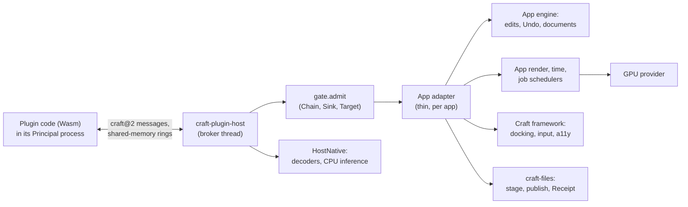

# ArtCraft plugin platform: specification for owner review

**Status (2026-11-20).**
- All 23 capability topics are **DESIGNED** and reconciled. Nothing is implemented or tested.
- Every number in this document is a hypothesis until a measured run exists.
- Design target: current mains, pinned in [source-baselines.md](source-baselines.md).
  - EffectCraft (EC) `f32ad3aa`
  - PhotoCraft (PC) `359051359`
  - craft-libs (CL) `e6dbc97ca`
- This document is the single summary to review and approve. Each section links to the detailed contract that implementation will follow.

---

## 1. What we are building

One plugin platform shared by every ArtCraft app, implemented first in EffectCraft and PhotoCraft.

**Goals:**
- Authors can build any plugin, including functional equivalents of the major After Effects and Photoshop plugins:
  - panels and floating windows;
  - tools and brushes;
  - effects and generators;
  - new object types, 3D and text;
  - temporal and audio work;
  - importers and exporters;
  - local AI;
  - batch jobs and automation.
- Plugins can use any app feature.
- The apps gain whatever host systems are needed, through **thin adapters** with full capability.
- Built-in features can themselves become plugins on the same public SDK. That keeps the base lean and proves the SDK is complete.
- Fast and native-feeling, measured rather than claimed. Simple, with one mechanism per need, and future-proof.

**Hard rules:**
- No plugin network access, direct or indirect.
- No store or marketplace.
- No Adobe binary or format compatibility.
- No capability removed for being hard.
- A document never activates code.
- Implementation runs phase by phase from current main, after your approval.

---

## 2. The system in one picture



**How the pieces divide the work:**
- **App engines** keep owning what they own today: documents, edits and Undo, rendering, timeline, save.
- **The Craft framework** owns windows, docking, controls, input, IME, focus, accessibility and theme.
- **The shared host** owns plugin identity, authority, execution, budgets and the SDK schema.
- **Each app's adapter** maps public operations onto its own engine. It owns no policy.
- **Plugins** own their algorithms and state, and ask for everything else.

---

## 3. Core concepts

| Term | Meaning |
|---|---|
| Package / release | A local folder or archive. A release is identified by `ReleaseDigest` (BLAKE3 of its canonical tree) and kept read-only in a host store. |
| Principal | `(PackageId, LineageKey)`, the unit of authority and of process isolation. The `LineageKey` is host-local and never saved. |
| Contribution | Something a package declares: a panel, command, tool, processor, object type, format, job or service. |
| Grant | A permission issued to a principal: `(Principal, Right, Scope, IssuedTo)`. Scopes are Invocation, Document, Session and Persisted. |
| Chain | Who caused an action: `[User \| Automation \| Plugin…]`. It is saved as **provenance** on anything the host may later replay. |
| Sink | Every kind of effect: a command, a document read or edit, a file, a spawn, a setting, a binding, print, clipboard or network. |
| Context ticket | Captured when a user acts. It binds one document, its targets, the principal's epoch and a **read set**. |
| Read set | `ReadKey → O(1) token` for everything a ticket or job read. A commit succeeds only if the tokens still match; otherwise the result is `Stale`. |
| Store | One Wasm instance inside a principal's process. The kinds are `ui`, `service`, `render` and `job`. |
| Generations | `PrincipalEpoch` (revoke or update), `ProcessEpoch` (crash), `MountEpoch`, `InteractionEpoch` and `DeviceGeneration`. These five are the only ones. |
| Receipt | The one typed outcome for any external file: `Unchanged`, `VisibleUnconfirmed(reason)` or `Durable`. |
| CacheKey / BakeKey | One key for every cache, and one durable identity for exact baked output. |

---

## 4. Subsystems

Each subsection gives the decision, its key interface, and the main alternative and why it lost.

### 4.1 Packages, identity and lifecycle · [runtime.md](contracts/runtime.md)

- **Install and consent.** A package is admitted by digest and enabled explicitly by the user. Updating keeps grants unless it asks for more, which needs consent. A developer link re-admits on every rebuild and shows a Developer badge.
- **Contribution classes are host contracts.** The classes are:
  - panels and slots;
  - commands, hooks and tools;
  - processors and object types;
  - properties;
  - formats, jobs and services.

  Inside a class, packages add any number of types without an app rebuild. A new class needs a host contract and an SDK release.
- **Missing plugins.** A missing or disabled plugin leaves inert, attributed state. The app still starts, opens, edits and saves the document.
- **Inter-plugin services.** Plugins depend on each other through `provides X@major` and `requires X@^major` declarations. A service call carries the caller's Chain, so a provider never gains authority. There is no lookup by name.

### 4.2 Execution: processes, Stores and turns · [runtime.md](contracts/runtime.md#processes-and-turns)

**All plugin code is Wasm.** Rust compiles to Wasm. JavaScript and TypeScript run on QuickJS compiled to Wasm, under Wasmtime. Wasm guests get no network, process or path imports.

| Process | When it exists | What runs there |
|---|---|---|
| **Principal process** | One per active plugin | `ui` Store (panels, hooks, tools, commands), warm `service` Stores, and fresh `render` and `job` Stores |
| **HostNative** | For plugin-triggered native decoding or CPU inference | Host code only: native app decoders and `tract`. The only place models are parsed |
| **GPU provider** | One per app per device | Host code. Each plugin gets its own logical device |
| **HTML** (optional) | When a plugin uses an HTML panel | A confined CEF tree, installed from Settings from a local archive |
| **NativeConfined** (optional) | For native plugin code | Only on an OS whose network-denial probes pass |

**How guest code runs:**
- **Async turns.** Every guest call is an async turn. Nothing blocks and nothing re-enters.
- **CPU-time budgets per turn:**

  | Turn | Budget |
  |---|---|
  | Hook | 50 ms |
  | UI | 100 ms |
  | Interactive tile | 5 s |
  | Exact tile | 60 s |
  | Decode | 30 s |

  Longer work uses a job. Progress messages never extend a deadline.
- **Overrun or crash.**
  - An overrun or trap recycles only that Store; panel state is restored from host-held `cx.state`.
  - A crash restarts the process with a new `ProcessEpoch`, and the mounts show placeholders.
  - Three strikes in 60 s quarantine the release.
- **Shared CPU credits.** One CPU credit ledger is shared with the apps' own rayon render work. Credits equal the core count minus a UI reserve. This keeps eight busy plugins from starving the compositor.
- **Data movement.** Bulk data moves through read-only shared-memory rings. Queries are served on a broker thread from an immutable `Arc<Snapshot>`, never from the app thread.

**Why this design.**
- *In-process Wasm*, which both apps use today (wasmi), puts the engine-bug blast radius inside the networked app process and stalls land on the UI thread.
- *One shared process for all plugins* would let an engine escape cross plugins' documents.
- *Several processes per plugin* costs more without adding safety.

### 4.3 Authority, security and no-network · [runtime.md](contracts/runtime.md#authority), [threat-model.md](architecture/threat-model.md)

**One gate for every caller.** UI, CLI, MCP and agents, scripts, headless runs, plugins, deferred jobs and replayed artifacts all go through `gate.admit(Chain, Sink, Target)`.
- The result is the **intersection** of every principal in the chain. The local user is just a principal with full rights.
- Sinks require an `Admitted<K>` token whose constructor is private, so no code path can skip the gate.
- PC's scattered `authorize`, `automation_gate` and `automation_input` flags (about 18 bypass sites) are deleted, so the compiler finds every site. A lint bans raw `Command::new`, `std::net` and file opens outside the gate.

**Provenance closes laundering.** A plugin cannot write something that the user later replays with full rights. Provenance is saved on:
- actions;
- presets and filter stacks;
- linked file locators;
- script references and expressions;
- shortcut, menu and startup bindings.

Replay runs as `[User, …authors]`. Security-relevant settings (network, scripts, automation, update) can never be changed under a plugin chain. Every saved file locator resolves through the file broker, so a network path needs the user to relink it.

**Network denial matrix** (Wasm is offline by construction; the OS layer adds defence in depth):

| Target | Enforcement | If the probe fails |
|---|---|---|
| macOS | Seatbelt profile with no network, no name-lookup daemons and no window server; signed `craft-worker` | That mode is `Unavailable` |
| Windows | One LPAC AppContainer SID per principal, a Job Object and an alternate desktop; firewall state monitored | Native and HTML are `Unavailable` |
| Linux and Flatpak | Our launcher applies seccomp (no sockets, foreign-arch kill, no ptrace) and Landlock (no `/proc`) | Native and HTML are `Unavailable` without Landlock |
| Web | Worker CSP with `connect-src 'none'`; no HTML panels | — |
| Headless | Same workers as desktop | — |

**Host deputies are gated too.** EC script sockets, the model `curl` downloader, helper processes, Reveal, print and font downloads are all sinks, denied whenever a plugin is in the chain.

**Not promised:**
- local timing side channels;
- exfiltration the user performs themselves (export, clipboard);
- data a plugin had already read before a revoke;
- engine-bug isolation *within* one plugin.

**Accepted residual risks:**
- The shared GPU provider (proved by `GPU-xprincipal`).
- CEF runs with its inner sandbox off; our OS sandbox around the whole CEF tree is the boundary.

### 4.4 UI: panels, windows, content and tools · [ui.md](contracts/ui.md), [ui-content.md](contracts/ui-content.md), [operations.md](contracts/operations.md#capture-and-preview)

**Panels and windows.**
- A plugin declares panels, inspector slots and dialogs. The host issues mounts inside Craft's normal tabs, floating groups, Window menu, focus cycle and saved layouts.
- "Native window" is a saved per-group preference, honoured only where the backend supports it. On Wayland without positions the group floats inside the app.
- Replacing a built-in panel needs an explicit user choice of a replaceable slot, and always keeps a one-click restore.
- Security chrome is host-only: permission prompts, pickers and recovery.

**Content model.** Plugins publish a **retained, keyed node tree**, never pixels for ordinary UI.
- The host renders real Craft controls: stacks and grids, tabs, inputs, sliders, menus, and virtualised lists, tables and trees.
- Custom drawing uses `Canvas` (logical scene plus hit map plus semantic tree), `GpuView` (a leased GPU frame) or optional `LocalHtml`.
- Accessibility, IME, theme and focus stay native.
- Updates are validated off the paint path and applied atomically. A bad update keeps the last valid body.

Rejected alternative: plugin-rendered UI images would duplicate IME, accessibility and controls, and add texture transfer.

**Tools and input.**
- Plugin tools register in the normal tool selector. One active tool owns each view. Input is claimed once at the originating viewport.
- Pen samples arrive ordered and bounded, with a sealed `End`.
- Previews are overlays kept out of committed and export state. Local feedback continues even if the plugin stalls.
- Eyedropper parameters are sampled by the host; plugins never read displayed pixels.
- Brokered HID/MIDI devices and camera, screen and microphone capture are available through user-picked grants (phase 6).

### 4.5 Commands, hooks and events · [operations.md](contracts/operations.md#commands-hooks-and-events)

**Commands.**
- One app command catalogue covers palette, menus, context menus, toolbars and shortcuts. Plugin commands enter it with stable keys, and the user's keymap resolves conflicts.
- Plugins can call only commands that have **typed handlers**. A CI ratchet only moves up, and SDK parity needs 100% of Domain and App commands typed.

**Hooks.**
- Veto, replace, wrap, disclose and observe are distinct authorities.
- Hooks run async under a deadline, with a fallback if they time out.
- Every nested command is admitted again at its real sink, so hooks cannot act as deputies.

**Events.**
- Document events come through a scoped, ordered outbox: open, close, save, selection, tool and committed changes.
- High-rate signals such as playback and progress coalesce.
- On overflow the stream reports a gap and resumes from an authorised snapshot plus watermark.
- An event can never mint edit authority.

### 4.6 Document queries and edits · [operations.md](contracts/operations.md#query-and-publication)

**The edit flow:**
1. A user action produces a **context ticket** bound to one document and its explicit targets.
2. `query.open` returns a bounded immutable snapshot lease. Paging is cursor-based and work-metered.
3. `edit.commit(ticket, label, ops)` stages typed, key-addressed **patches** in one engine-owned candidate, away from paint.
4. At the owner's publication point the host compares the read-set tokens, then rechecks the target, grants and `PrincipalEpoch`.
5. The result is **one Undo**, with the receipt and outbox published together. Otherwise it is `Stale(changed keys)` with zero edits.

This replaces "whole-document revision" checks. Unrelated user edits no longer kill long jobs, and undo-back-to-identical content is handled correctly.

**Other rules:**
- **Multiple documents.** A ticket never retargets. `doc.list` and `doc.ticket` mint per-document tickets from the user's chain, and each document gets its own Undo and receipt.
- **Engine refactors.**
  - EC extracts pure target-resolved plans from `session/{dispatch,edit}.rs`.
  - PC moves path, Action, selection and history state out of ambient session state at `session/execute.rs`, `jobs.rs` and `actions_cmds/history.rs`.
  - No guest action ever retargets the active document.

### 4.7 Persistent objects, properties and project files · [document.md](contracts/document.md)

**One record format.**
- One versioned `ExtensionRecord` (in CL `plugin-api::doc`) attaches to app-owned objects or fills a native extension variant: EC `LayerSource::Extension`, PC `LayerContent::Extension`, Smart Filter, adjustment, track, clip, transition or geometry.
- The record holds the type key, schema version, bounded opaque state, typed properties, host-remappable references, asset references and provenance.
- It binds by `PackageId + TypeKey + SchemaVersion`, so a project opens live on any machine that has the plugin.

**Properties.**
- Typed properties use each app's normal keyframes, expressions, parameter groups and inspectors.
- Cycles are refused. Temporal recursion needs an explicit horizon.

**Missing plugins and old readers.**
- A missing plugin leaves its bytes untouched, with an inert or last-good preview.
- An older app that can't keep every byte refuses to overwrite the file.

**Save formats.**
- EC keeps its text format, plus a self-contained ZIP when extension assets are embedded.
- PC uses its manifest and blob store.
- Every save goes through `craft-files` and returns a `Receipt`.

**Migration and exact export.**
- A migration is one staged Undo.
- Exact export needs complete results or a verified `BakeKey` match. An unverified bake is shown only as a labelled preview.

### 4.8 Rendering: CPU, GPU, 3D and text · [render.md](contracts/render.md)

**Processors.**
- A processor receives an immutable, typed `ProcessRequest`:
  - explicit pixel format, colour and ICC, alpha, precision and coordinates;
  - region of interest;
  - time;
  - `ExecProfile`.
- It returns a plan: tiles, analyse-then-tiles, or full frame.
- The host expands footprints, authorises and stages inputs, and composites the result with native masks, blends and opacity.
- Guest-initiated reads use `render.read`, which follows the same rules and adds to the read set.

**GPU.**
- General plugin WGSL runs on the plugin's own logical device in the GPU provider, never on the app's display device.
- Plugins receive typed handles, never device pointers.
- Results come back as sealed CPU data or a fenced, proven import.
- Software adapters (WARP, lavapipe) are advertised only where they ship.

**3D.**
- Typed meshes, materials and passes join EC's native scene with camera, lights and depth.
- PC accepts projected or rendered imagery.

**Text (TEXT-01).**
- Brokered shaping over installed fonts only, returning a `GlyphRun` with provenance.
- Font downloads are a denied network sink.

**Caching and exact output.**
- One `CacheKey` for every cache.
- Exact mode accepts only complete coverage plus verified provenance under a pinned `ExecProfile`.
- Output is staged privately and published per file with a `Receipt`.

### 4.9 Time and audio · [time.md](contracts/time.md)

**Time model.**
- Time is a signed rational coordinate that names its clock: composition, layer, source or sample.
- The app maps holds, reversal, remaps, shutter samples and frame boundaries.
- Neighbour-frame and temporal plans declare their reach.

**Feedback and state.**
- Feedback has a canonical step and a base case. Host-held checkpoints with verified lineage make seeking and restarts deterministic.
- State crosses requests only as host-held checkpoints. One warm Store per lane is allowed.

**Audio.**
- Plugin DSP runs **ahead** of the device in a bounded feeder.
- The device callback only copies preallocated data. It never runs guest code, allocates or waits.
- Offline export uses the same mix, distinguishing authored silence from a decode failure.
- `AudioWindow` inputs let visual effects react to audio (Sound Keys class), with precise invalidation.
- PC advertises no audio role.

### 4.10 Files, formats, jobs and local AI · [io-jobs.md](contracts/io-jobs.md)

**Files.**
- Plugins see **handles, never paths**. Grants come only from host pickers, drops, the relink sheet or the app's own Open, Save As and Export dialogs.
- Every open resolves *beneath* the held OS handle. The open refuses:
  - `..`;
  - links;
  - mount crossings;
  - protected locations, such as autostart, `.ssh`, shell rc files, `.git/hooks` and app config;
  - remote volumes the user didn't pick.
- A cloud placeholder downloads only when the user explicitly picks it.

**Publishing.**
- `craft-files` (absorbing CL's existing `craft-atomic`) stages every external write.
- It rechecks the destination's identity, exchanges or replaces it, and journals a typed per-file `Receipt`.
- **The apps' own Save, autosave and export use it too.** Today PC over-reports durability at three sites, and EC truncates export files in place and deletes them by path on cancel.

Deletion is protected:
- it goes to the trash by default;
- permanent delete applies only to the plugin's own files;
- a job pauses after 50 replacements of pre-existing files.

**Formats.**
- A `FormatContribution` reader *is* the importer, and its writer is the exporter. Both appear in the native Open, Save As, Export and EC Render Queue, with typed export options.
- A lossy writer can't silently own Ctrl+S.
- Native app decoders run confined in HostNative when a plugin triggers them.
- URLs in imported files are inert.

**Jobs.**
- **Priority.** The host assigns the class: Interactive, UserWaiting or Background. Each package gets at most half of each contended pool.
- **Commit.** Jobs record read sets and commit or report `Stale`. Plugin jobs never lock the document, so Save stays available.
- **Resume.** `job.unit` memoization validates persistent fingerprints, so a job can resume after a restart.
- **Batches.** Batch work uses hidden scratch documents.

**Local AI.**
- One `infer` service runs CPU inference (tract, in HostNative) or GPU inference on the plugin's own logical device.
- Models are package members or granted files, pinned by sha256, and **never downloaded**.
- A GPU reset quarantines that plugin's GPU route and reruns the job on CPU.

### 4.11 SDK, ABI, versioning and author workflow · [sdk.md](contracts/sdk.md), [sdk-examples.md](contracts/sdk-examples.md)

**ABI.** One core-Wasm ABI, `craft@2`:
- 5 imports: `memory`, `submit`, `read`, `write`, `log`;
- 3 exports;
- one strict CBOR envelope, decoded once on the broker thread;
- a pinned Wasm feature profile.

**Rust types are the source of truth.**
- `#[craft::api]` writes checked-in lock files: `api.lock`, `<app>.lock` and `engine.lock`.
- One generator produces the TS bindings, docs, MCP/CLI descriptions, a fake test host and conformance cases.
- **One validator** replaces PC `param_check.rs`, EC `cmd/schema.rs` and the beta's handwritten `.d.ts`.

**Evolution rules.**
- **Live calls.** Live calls are strict and writes are patches. Newer enum values arrive as `Other{raw}`, and newer semantic fields block blind overwrites.
- **Majors.** Every published operation major is served **forever** through pure up/down mappers.
- **Command ids.** Every engine command id ever shipped stays in `engine.lock` forever, with aliases and argument migrations. Saved Smart Filters, Actions, keymaps and EC effects survive refactors.

**Proved by simulation.** A refactor that splits PC's command tables, moves PC to a linear working space and replaces its widgets leaves old binaries and saved documents working. The plugin platform files touched are the regenerated `engine.lock` plus a handful of adapter files (`ops/filter.rs`, `render.rs`, `color.rs`). PC's own UI change touches nothing on the plugin side.

**Legacy families run through bundled shims over the one ABI:**
- PC `pc_abi` 1;
- EC `ec_api` 1/2;
- beta `craft_abi` 1;
- EC `.jsx` ScriptUI, on an asyncify build where each synchronous wait becomes a normal turn.

**Capabilities.**
- Static needs are checked at enable time. An unmet need disables only that contribution.
- `host.capabilities()` reports run-time facts only, never app names, OS or vendor.

**Determinism.**
- Exact output uses `Canonical` mode: NaN canonicalisation and no relaxed-SIMD.
- Caches never mix determinism classes.

**Author workflow.**

| Command | What it does |
|---|---|
| `craft new` | Scaffolds a project from 7 templates, in Rust or TS |
| `craft types` | Generates the bindings |
| `craft dev` | Hot re-link |
| `craft test` | Runs against the fake host |
| `craft check` | Static checks |
| `craft replay` | Replays a recorded transcript under lldb or DevTools, with no authority |
| `craft pack` | Packs the release |

A missing permission is a **compile error** that names the `craft.toml` fix.

```ts
export default command({ id: "prefix", label: "Prefix Layers…" }, async (cx) => {
  const { layers } = await cx.query(doc.selection.layers({}));
  const p = await cx.ui.prompt({ title: "Prefix", value: "fx_" });
  if (p) await cx.commit("Prefix layers",
    layers.map(l => doc.layer.rename({ layer: l.id, name: p + l.name })));
}); // If the user renamed a layer meanwhile: OpError{code:"Stale"}, no Undo
```

```rust
#[craft::props] struct Glow { radius: Px, #[range(0.0, 4.0)] gain: f32 }
#[craft::processor(id = "glow", role = Filter, props = Glow)]
fn plan(r: &ProcessRequest<Glow>) -> ProcessPlan {
    ProcessPlan::tiles().input(0, r.coverage.expand(r.props.radius.ceil_i()))
        .want(ImageDesc::rgba_f32(Color::SceneLinear, Alpha::Associated))
}
```

**Targets.**

| Target | Status |
|---|---|
| macOS, Windows x64, Linux | Primary |
| Windows arm64 | Pending measurement |
| Web | Pending its broker Worker: WebGPU in the worker, no HTML panels |
| Headless | Same workers, no UI |
| Wayland | Floats in-app |

---

## 5. What authors can build

Each workflow is built twice, once per app, as an original public-SDK plugin. It registers a result or an honest `Unavailable(reason)` per app.

| # | Workflow | Functional class | EC / PC |
|---|---|---|---|
| 01 | Dockable control studio | Panel suites, workspace tools | both |
| 02 | Procedural particle layer | Particle systems | EC / no native role |
| 03 | Wet pigment canvas | Custom brush engines | — / PC |
| 04 | Temporal denoiser | Temporal denoise | EC |
| 05 | Offline segmentation | Select subject, roto assist | both (stills) |
| 06 | Colour grader | Grading suites and LUT tools | both |
| 07 | 3D workspace | 3D object renderers | EC / projected in PC |
| 08 | Shape/text generator | Generators, bulk layout | both |
| 09 | Tracking and rotoscope | Planar and point trackers | EC |
| 10 | Layer and effect explorer | Large-project navigators | both |
| 11 | Offline format importer | Custom codecs and formats | both |
| 12 | Timeline and workspace tools | Script launchers, timeline helpers | EC / common slots in PC |
| 13 | Audio analysis | Beat markers | EC |
| 14 | Batch composer | Batch processing over files and open documents | both |
| 15 | Inter-plugin services | Shared libraries between plugins | both |
| 16 | First-party extraction | Built-in feature moved to a plugin | both |
| 17 | Keyer | Keying with host eyedroppers and matte view | both |
| 18 | 3D and extruded text | 3D text | both |
| 19 | Audio-reactive visuals | Audio-driven animation | EC |
| 20 | Generative fill | Local-model fill | both |
| 21 | Resource library | Brush, pattern, gradient, swatch and LUT managers | both |

Details: [proof-inventory.md](implementation/proof-inventory.md).

**Proving the base can stay lean.** Five built-in features are rebuilt strictly as public-SDK plugins, each covering a different kind of feature:

| Feature | Kind |
|---|---|
| PC Stylize (with Oil Paint) | Tiled CPU, Smart Filters, Actions |
| EC Echo | Timed, GPU |
| PC Liquify | Modal UI, tool, ROI processors |
| EC Track Motion | Job, overlay, panel, persistent record |
| EC Primitive layer | Rendered persistent object |

Their hard-coded id lists in the apps become declared metadata. If one can't match native, only that one stays native, and the gap is tracked as a host-contract defect.

---

## 6. What changes in each app

| Area | EffectCraft | PhotoCraft |
|---|---|---|
| UI | Port `dock.rs`, `dock_ui.rs` and `workspace_state.rs` onto the shared Craft framework *before* plugin panels. Replace focus-after-draw forwarding with input claims. | Dynamic descriptors through `panels/registry.rs` and `panel_docking.rs`. Input and modal order in `app/frame.rs`. Inspector slots in `properties.rs`. |
| Authority | Admit in `Session::execute` before `enabled`. Script `Socket`, model `curl` and prefs become gated sinks. | Delete the `authorize`, `automation_gate` and `automation_input` fields and gate thread-locals. Admit at `Session::dispatch` and about 18 side sinks. The Action boolean becomes provenance. |
| Edits | Pure plans in `session/{dispatch,edit}.rs`; `cmd!` and `query!` get typed arms. | Explicit target history in `session/execute.rs`, `jobs.rs` and `history.rs`; registry handlers become typed functions. |
| Objects | `LayerSource::Extension`, effect attachment, ZIP archive when assets are embedded | `LayerContent::Extension`, Smart Filter and adjustment record, manifest and blob store |
| Render | `effects/src/plugin.rs`, `render/src/{pipeline,accel,three_d}`, export staging | Smart Filter `rendering` and `stack_cache`, compose, high-depth CPU path |
| Files and jobs | Export `out.rs` and `pipeline.rs` move to `craft-files`. `background/jobs.rs` joins the ledger. Roto cache moves to `cache.put`. | `format/src/{atomic,noreplace}.rs` lifted into `craft-files`. `jobs.rs` joins the shared state machine. Batch scratch sessions. |
| Identity | `engine.lock`; effect ids resolve through `craft-idmap` | `engine.lock`; Smart Filter, Action, keymap and toolbar ids resolve through `craft-idmap` |
| Removed later | In-app Wasm loader, Plug-in Library network code, boa script engine | In-app wasmi loader and plugin install commands |

**Shared (CL):**
- `plugin-api` (including `plugin-api::doc`);
- `plugin-sdk`;
- `sdk-gen`;
- `craft-idmap`;
- `craft-plugin-host`, `craft-plugin-ipc` and `craft-plugin-confine`;
- `craft-files`;
- `plugin-conformance`;
- `testkit::pair`.

**The old beta in `craft-extensions`** is historical. Useful parts are rewritten onto these crates, not ported: `ext-runtime` → host, `ext-ipc` → IPC, and the `ModelStore` digest store.

---

## 7. Performance and conformance · [conformance.md](contracts/conformance.md)

**One paired harness.** `testkit::pair` is used by both apps. It measures:
- **C**: UI-thread CPU per stage, including a per-plugin stage;
- **I**: frame interval and long stalls, which catches GPU jank;
- **L**: input to the end of the consuming frame;
- **P**: EC playback on-time ratio against the audio clock;
- GPU timestamps.

Runs interleave the native (A) and plugin (B) arms in ABBA blocks, plus an **A0** arm with the host off to catch shared regressions.

**Verdict rules:**
- Deterministic counters gate every PR on hosted CI: copy bytes, UI fence waits, idle wakeups, leaks, envelope bounds.
- Timing verdicts count only on a *calibrated* runner: at least 59 A/A runs with no false failures, plus positive controls that must fail.
- Pooled results allow at most 5 looks.
- An `Inconclusive` result never blocks a PR, only deleting old code or making release claims. At a phase exit it becomes a tracked defect.

**Tolerance.** `allow = max(floor, 10% of native)`.

| Class | Floor |
|---|---|
| UI | 1 ms CPU p95, 0.5 pp missed frames, one refresh of latency, ≤1 long stall per 10k frames |
| Command | 50 ms, plus a hard 100 ms p95 ceiling when native is under 100 ms |
| Playback | −1 pp on-time |
| Export and GPU | 10% |
| Host-on overhead versus host-off | 15% p50 |
| Kernel throughput | Not gated. Below 0.6× native opens a defect |

**Work budgets.** Budgets are charged on actual work at choke points the guest can't bypass: pixels × taps staged, credits, GPU and UI publish.

**Fault grid.** Fault classes × execution modes × OS, generated from the capability table. It covers:
- malformed input;
- traps and infinite loops;
- out of memory and GPU loss;
- kill, cancel and revoke races;
- network attempts;
- contention and floods;
- adapter panics;
- autosave killed mid-write;
- disk full;
- audio device loss;
- re-entry;
- quotas;
- alias spoofing;
- migration races.

**Author observability.**
- Per-plugin log rings, treated as document data.
- The host logs typed codes only, never plugin strings. Crash reports carry no plugin text.
- `cx.profile.self()` sees only the plugin's own work.
- Transcripts are developer-only, capped at 64 MiB and expire after 7 days.

**Completeness is machine-checked.** The coverage lint in `plugin-conformance` maps every question to its ADR, contract, per-app slice, tests and run IDs. A TESTED claim must cite a real successful CI run at the pinned SHA.

---

## 8. Legacy migration and what gets deleted · [legacy-inventory.md](implementation/legacy-inventory.md)

**Retirement rules.** Each old path retires in its own PR in phase 7, and only when all of these hold:
- the legacy corpus survives;
- the path has no callers;
- its ids resolve or are tombstoned;
- its settings are migrated once;
- headless and downgrade cases pass;
- a calibrated timing **Pass** exists;
- no open defect remains on that id.

| Old path | Fate |
|---|---|
| PC wasmi plugins and their install/remove commands | Run through the `pc_abi` shim; `plugin.run` alias kept, other commands tombstoned |
| EC Wasm v1/v2 effects | `ec_api` shim; v2 neighbour reads become a timed plan |
| **EC Plug-in Library** | **Network download and catalogue deleted.** SHA-verified installs migrate once, after consent. A mismatched install gets an "origin unverified" adoption. |
| EC `.jsx` scripts and boa | Asyncify QuickJS shim; Startup and Shutdown scripts run after consent; `Socket` returns `Unavailable(NoNetwork)` |
| EC `helper-host`; automation policies | Kept, as NativeConfined and Automation principals respectively |
| PC `authorize` flags, PC `param_check.rs`, EC `cmd/schema.rs`, slow-frame meters | Replaced by the gate, the one validator and the probes |
| Beta ABI 1 | Shim. Native-full mode, network mode, store and Adobe hosts are not ported. |

Adoption records bind each legacy id to (path, sha256, ABI), so no other package can claim it.

---

## 9. Phase plan · [phases.md](implementation/phases.md)

Every slice is one reviewable PR from the pinned baseline. It goes into your `arnav-hiwarkar/*` forks or Forgejo, never a storytold remote. Builds run only in approved Actions jobs. Counters gate merges.

| Phase | What lands | Exit gate (highlights) |
|---|---|---|
| **0a** | Docs move into CL; test registry and coverage lint | Lint catches today's defects |
| **0b–0d** | `testkit::pair`; PC and EC paired perf runs; C/I/L/P probes | First counters and A/A records |
| **0e** | App id-keyed lists become declared registration tables | Behaviour unchanged |
| **0f** | Legacy corpus captured from today's code | Every legacy path covered |
| **0g** | `engine.lock` and `craft-idmap`; the authority gate and provenance; `craft-files` for the apps' own saves | Alias, lint, policy-diff and laundering tests; crash-safe save on APFS, ext4 and NTFS |
| **0h** | One framework revision and one egui family for both apps | Verified resolved deps |
| **1** | Runtime kernel: API crates, broker, confined Principal processes, rings, ledger, WorkMeter | Nothing loads by default until network denial, identity, bomb, oversubscription, cost, fuzz and log-redaction tests pass |
| **2** | Typed edits in both engines, operations, file grants (read-only first) | Crash-commit, adapter-panic, lost-update |
| **3** | EC dock port; plugin panels, content and tools in both apps; Liquify UI spike | UI freeze after cadence, latency and stall gates |
| **4a0, 4a** | Extension record plus Smart Filter attachment; processors; legacy shims; Stylize and Echo extractions | Processor contract freezes after PAR tests |
| **4b–4d** | Files, formats and jobs; time and audio; GPU provider and inference | IO, JOB, TIME, AUD and GPU suites |
| **4w** | Web broker and WebGPU | Web tests (Stylize's deletion waits on this) |
| **5** | Persistent objects in both apps; Track spike; `.jsx` shim | DOC suite, autosave kill, safe mode, downgrade |
| **6** | Conformance kit and CLI; Liquify, Track and Primitive packages; text, eyedropper, audio window; multi-document; resources; devices; REF-01–21 | Typed ratchet at 100%; every REF cell passes or is honestly unavailable |
| **7** | Cutovers and deletions, one per PR | Section 8 rules |

**Tracks after phase 2:** NativeConfined per OS, HTML/CEF, and Windows arm64. Each stays `Unavailable` until its own gate passes.

---

## 10. Limits and open verification

**Platform facts to prove, not assume:**
- macOS seatbelt SPI and JIT entitlement;
- Landlock under Flatpak;
- Windows LPAC DNS behaviour;
- the `ReplaceFileW` race window;
- Flatpak portal inode stability;
- CEF size and cold start (estimated 150–250 MB, 0.3–0.8 s);
- QuickJS-Wasm speed for UI and scripts;
- Wasm kernel throughput versus native rayon;
- Pulley speed on Windows arm64;
- NaN-canonicalisation cost (≤15%).

**Not guaranteed:**
- bit-identical inference across devices (results are keyed by backend);
- honest fsync on SMB, NFS and FUSE;
- Linux plain sync folders being detected as remote;
- an interactive debugger inside the sandbox (replay is the answer);
- present-to-glass latency;
- anything listed under "Not promised" in 4.3.

**Review independence.**
- UI-01 through RENDER-03 ran on GPT-6.2 Sol.
- IO-01 onward ran on Claude Opus 5.5, after Sol's usage limit. Each role ran in a separate context, but not across model families. The same applies to the final review that produced 24 corrections, all applied.
- Full trail: the workshop records kept outside this repository.

---

## 11. What your approval covers

Approving this spec authorises implementation to start at phase 0a under the rules in section 9. These items are product or infrastructure calls rather than engineering ones, so they are listed for your explicit sign-off:

1. **Scope of change.** New crates in craft-libs and adapter changes in both apps, landing through your forks or Forgejo, one PR per slice. The design docs move into CL `docs/plugin-platform/` in phase 0a.
2. **Framework convergence (0h).** EC moves to the same Craft framework revision as PC, and ports its dock *before* plugin panels ship in EC.
3. **App behaviour changes users will notice.**
   - Saves report durability honestly.
   - EC export no longer truncates in place.
   - Plugin and script installs need one-time consent to migrate.
   - EC's Plug-in Library loses its online catalogue.
4. **HTML panels via an optional CEF component**, about 150–250 MB, installed from Settings from a local archive. Until then HTML panels fall back to native content.
5. **Accepted residual risks:** the shared GPU provider, CEF's inner sandbox being off, and the items under "Not promised" in 4.3.
6. **Performance bar:** an extracted feature must be within `max(floor, 10%)` of native, or that feature stays native. A self-hosted benchmark Mac is optional and needs your separate authorisation.
7. **CI usage:** paired perf jobs run nightly or on approval in Actions, within a macOS minutes budget you set.

---

## Detailed documents

| Area | Decision | Contract | Tests |
|---|---|---|---|
| Panels and windows | [ADR-UI-01](decisions/ADR-UI-01.md) | [ui.md](contracts/ui.md) | [ui-01](implementation/ui-01-acceptance.md), [slices](implementation/ui-01-slices.md) |
| UI content | [ADR-UI-02](decisions/ADR-UI-02.md) | [ui-content.md](contracts/ui-content.md) | [ui-02](implementation/ui-02-acceptance.md) |
| Input, commands, edits | [ADR-UI-03](decisions/ADR-UI-03.md) | [operations.md](contracts/operations.md) | [edit](implementation/edit-acceptance.md) |
| Persistent objects | [ADR-DOC-02](decisions/ADR-DOC-02.md) | [document.md](contracts/document.md) | [document](implementation/document-acceptance.md) |
| Rendering | [ADR-RENDER-01](decisions/ADR-RENDER-01.md) | [render.md](contracts/render.md) | [render](implementation/render-acceptance.md) |
| Time and audio | [ADR-RENDER-03](decisions/ADR-RENDER-03.md) | [time.md](contracts/time.md) | [time](implementation/time-acceptance.md) |
| Files, jobs, AI | [ADR-IO-01](decisions/ADR-IO-01.md) | [io-jobs.md](contracts/io-jobs.md) | [io](implementation/io-acceptance.md) |
| Runtime and authority | [ADR-RUN-01](decisions/ADR-RUN-01.md) | [runtime.md](contracts/runtime.md) | [runtime](implementation/runtime-acceptance.md) |
| SDK and evolution | [ADR-RUN-03](decisions/ADR-RUN-03.md) | [sdk.md](contracts/sdk.md), [examples](contracts/sdk-examples.md) | [sdk](implementation/sdk-acceptance.md) |
| Conformance and retirement | [ADR-SDK-02](decisions/ADR-SDK-02.md) | [conformance.md](contracts/conformance.md) | [conformance](implementation/conformance-acceptance.md) |

**Ledgers:**
- [question closure](question-closure.md): every bank question mapped to its decision and tests;
- [conflicts and supersessions](cross-topic-conflicts.md);
- final review and corrections (workshop records kept outside this repository).
