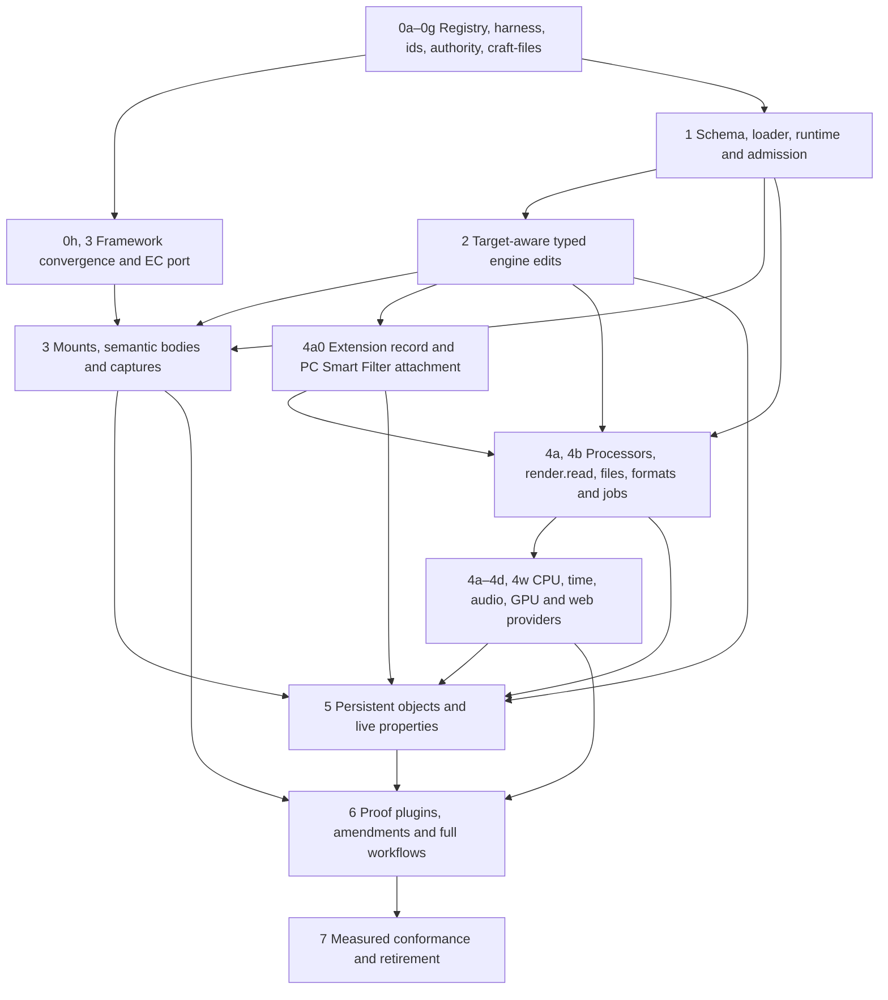

# Implementation dependencies

The graph distinguishes implementation prerequisites from acceptance gates. Node labels carry the canonical [phase](phases.md#phases) IDs. An earlier slice may prove a smaller workflow on real providers. The complete contract and the later workflow gates remain part of the same program.

- The framework pin and stubs can proceed in parallel with the worker and semantic schema after design approval. EffectCraft's normal dock port needs staged built-in layout and behavior proof before the extension mount.
- The mutation and render impact map is shared across built-in and extension callers. A render or write provider advertises only the domain and authority that the adapter implements. Deferred callbacks and macro leaves use the same principal.
- UI and processor dependencies need shared lease, revision and availability semantics up front. Prove small native controls before expanding provider options. Prove producer-loss fallback before offering a GPU view publicly.
- New object persistence depends on typed edits, render requests and archival support. The extension record lands in 4a0 so the Stylize extraction and legacy shims have a `TypeKey`; `DOC-roundtrip` gates it. A project compatibility claim for the remaining roles requires real app open, edit and save in phase 5.
- The Liquify spike in phase 3 covers only the UI body and tool capture, so UI-01-FREEZE does not wait on 4a processors. The full `PAR-pc-liquify` is in phase 6.
- Slices branch from the pinned baseline into the owner's arnav-hiwarkar/* forks or Forgejo, never a storytold remote; builds run only in approved Actions jobs.
- Old data and legacy workflow proofs are inputs to each cut, including host and provider behavior not used by the first vertical slice. The owner can approve work phase by phase after the full design is reconciled.

[Phase outline](phases.md) · [UI-01 slices](ui-01-slices.md) · [Proof inventory](proof-inventory.md)
